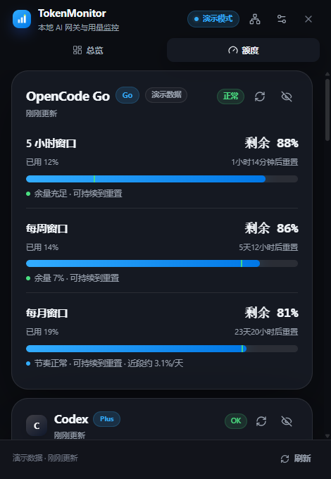
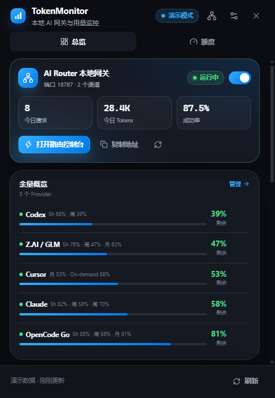
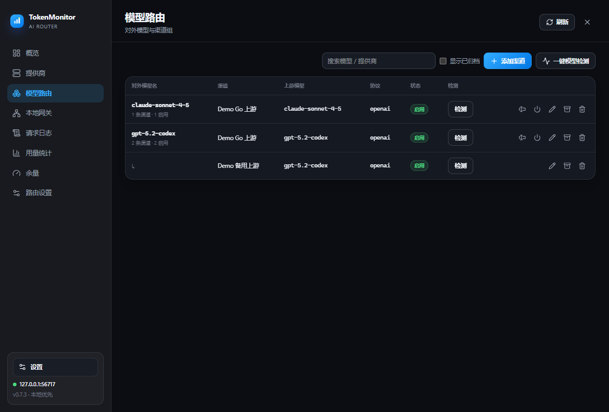
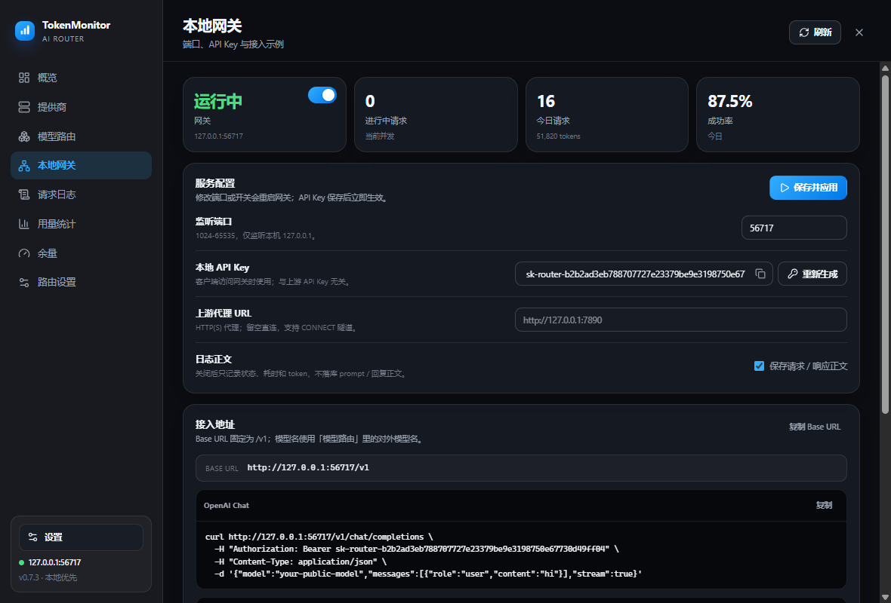
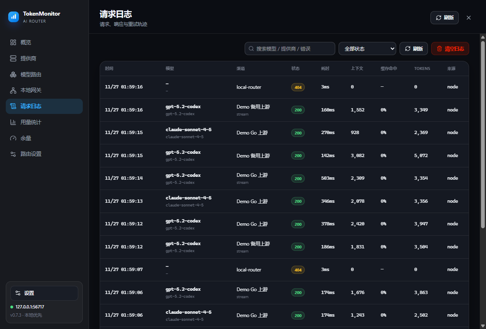
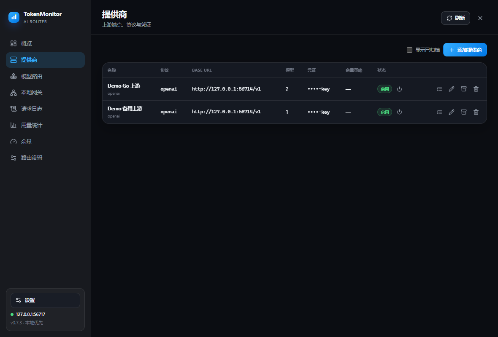
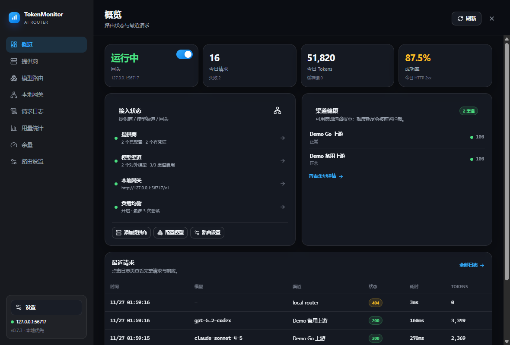

# TokenMonitor

Windows 托盘版 AI 额度监控 + 本地 AI 路由网关：悬浮球常驻桌面、独立面板、多 Provider 余量与本地路由网关一体化。参考 [CodexBar](https://github.com/steipete/CodexBar) 与 [ai-router](https://github.com/q2316367743/ai-router) 的产品设计，使用 Electron + React 独立实现。


## 功能

### 余量监控

- **多 Provider 额度面板**：OpenCode Go、Codex、Claude、Cursor、Z.AI / GLM、ZCode；每个 Provider 独立显示额度窗口、重置时间和异常状态。
- **OpenCode Go 三窗口余量**：5 小时、每周、每月；剩余/已用百分比、重置倒计时、限流状态。
- **pace 节奏预测**：按窗口时间进度比较实际消耗，提示"余量充足 / 节奏正常 / 偏快"。
- **路由提供商余量**：DeepSeek、OpenRouter、Moonshot、SiliconFlow 等 25 家内置策略，显示窗口余量与**金额余额**；额度耗尽自动阻断渠道。
- **Codex 额度重置积分**：显示可用重置次数与下一次过期倒计时。



### 悬浮球与面板

- **悬浮球**：常驻桌面的 56px 圆窗，外环为所选供应商余量、中心为百分比或余额；右键切换**展示口径**（全部窗口最低 / 金额 / 5 小时 / 周 / 月）与余量来源；主进程拖拽循环，跟手拖动，位置自动记忆。
- **独立面板窗口**：点击悬浮球或 Windows 托盘图标，面板在触发按钮周围锚定展开（macOS 菜单栏下方 / Windows 任务栏上方）；失焦自动隐藏、Esc 收起；未配置悬浮球时可从托盘独立打开。
- **实时状态推送**：余量、服务状态、路由数据全部由主进程广播，面板与悬浮球零轮询。

 

### AI 路由（本地网关）

- **三协议入口**：OpenAI Chat / Anthropic Messages / OpenAI Responses，3×3 协议转换，按对外模型名组成渠道组，自动故障转移。
- **负载均衡**：可用度权重、会话亲和、额度前置拦截；只在尚未向客户端写出字节时改道。
- **请求日志与用量**：记录最终渠道、状态、耗时、TTFT、token 明细与重试轨迹；请求头/响应头以可折叠 JSON 树查看；按日/小时聚合，提供成功率、缓存、趋势与**Agent → 提供商 → 模型**三列流向图。
- **实时速率**：主进程滑动窗口聚合 tokens/min，悬浮球之外的监控面板随请求即时更新。

<p>
  
  
</p>
<p>
  
  
</p>

### 体验

- **路由控制台**：独立窗口，概览、提供商、模型渠道、本地网关、请求日志、用量统计、余量、路由设置八个页面；模型组支持整组重命名与启停。
- **设置页与路由台同构**：侧栏、顶栏、底部按钮逐像素对齐，切换无跳动。
- **服务状态监控**：OpenCode（自建状态页）、OpenAI / Codex、Anthropic / Claude、Cursor 四家；降级、事故数与受影响组件。
- **Windows 原生体验**：系统托盘（左键开合面板、右键菜单）、Toast 通知、开机自启、单实例、深色/浅色主题（#0099FF / #FDFDFE / #FD2201 配色）。
- **隐私优先**：凭证用 Windows DPAPI 加密；不读取 prompt、回复、工具输出或其他 Provider 的 Key；不接入遥测。

## Provider 接入

| Provider | 自动来源 | 手动凭证 |
|---|---|---|
| Codex | `~/.codex/auth.json`（OAuth） | OAuth access token |
| Claude | `~/.claude/.credentials.json`，或 `CLAUDE_OAUTH_TOKEN` | Claude Code OAuth token |
| Cursor | Cursor `state.vscdb` 中未加密的 access token | cursor.com Cookie header 或 session token |
| Z.AI / GLM | `Z_AI_API_KEY` / `BIGMODEL_API_KEY` 等环境变量；ZCode 的 Z.AI Key | API Key；团队 BigModel 可粘贴 JSON |
| ZCode | `~/.zcode/v2/config.json` 的 Coding Plan Key | API Key；团队版 JSON |
| AI Router 提供商 | — | Base URL + API Key / OAuth / Cookie |

设置 → **常规** 为每个 Agent 独立开关并保存凭证（手动凭证系统加密保存，不会传给渲染进程或写入日志）；设置页的「悬浮球」区可切换悬浮球开关、展示口径与余量来源。

BigModel 团队版需要额外选择器，可粘贴：

```json
{
  "apiKey": "<BigModel API key>",
  "organizationId": "<Bigmodel-Organization>",
  "projectId": "<Bigmodel-Project>",
  "region": "bigmodel-cn"
}
```




## 安装 / 运行

从 [GitHub Releases](https://github.com/handsometaoa/TokenMonitor/releases/latest) 下载安装包：

- **Windows**：NSIS 安装包（x64）
- **macOS**：DMG（x64 与 arm64，CI 自动构建）
- 每个安装包附 `sha256` 校验文件

从源码运行：

```bash
npm install
npm run dev          # 开发
npm run dist:win     # Windows NSIS 安装包，产物在 release/
```

安装包未签名：Windows SmartScreen 可能提示，选择"更多信息 → 仍要运行"；macOS 首次打开若被 Gatekeeper 拦截，在"系统设置 → 隐私与安全性"里允许，或执行：

```bash
xattr -cr /Applications/TokenMonitor.app
# 或
sudo xattr -rd com.apple.quarantine /Applications/TokenMonitor.app
```

## 首次使用

1. 打开 [OpenCode 控制台](https://opencode.ai/auth) 创建 API Key。
2. 在引导页粘贴 Key，点击"测试并保存"；也可以尝试检测本机 `auth.json`。
3. 需要更多 Provider 时，打开"设置 → 常规"，先登录对应客户端（Codex / Claude），或填 API Key / Cookie。
4. 需要本地路由时，打开"路由控制台 → 本地网关"启动网关（默认关闭，仅监听 `127.0.0.1`），在"提供商"里配置上游并在"模型路由"建立对外模型映射。
5. 右键悬浮球可随时切换余量展示口径或隐藏悬浮球。

本机如果只有其他 Provider 的凭证（例如 DeepSeek），不会被读取或展示；OpenCode 额度必须使用 OpenCode Go 的 Key。其他 Provider 的凭证只在各自设置中读取。

## AI 路由（本地网关）

托盘菜单 →「路由控制台…」打开独立控制台，共八个页面：

- **概览**：网关状态、今日请求 / Tokens、渠道健康、接入状态检查单、最近请求。
- **提供商**：Base URL（完整 API 根，含 `/v1`）、协议（openai / anthropic / openai-responses）、API Key / OAuth token / Cookie、余量策略。
- **模型路由**：对外模型名 → 上游模型名；同名多行即一个渠道组，由负载均衡选路。支持整组重命名、整组启停与单渠道编辑/归档/删除。
- **本地网关**：默认关闭，启动后只监听 `127.0.0.1:<port>`；服务开关置顶，本地 API Key 内嵌复制图标，可随时重新生成。
- **请求日志**：状态、耗时、TTFT、上下文、缓存命中、来源客户端；正文按需落库（可关闭），鉴权头自动剔除。
- **用量统计**：成功率、缓存、TTFT、输出速度趋势、Token 分类分解、活跃度热力图、三列流向图。
- **余量**：所有绑定余量策略的提供商窗口与余额。
- **路由设置**：负载均衡总开关、会话亲和、额度前置拦截、最大尝试渠道数。

内置 **25 家余量策略**：OpenCode、Z.AI、Codex、Claude、Cursor、DeepSeek、OpenRouter、Moonshot、SiliconFlow、MiniMax、AiAnd、Chutes、DeepInfra、ElevenLabs、Venice、xAI、Warp、Crof、ZenMux、NeuralWatt、LLM Proxy、LiteLLM、Codebuff、Custom HTTP、Custom JS。日志保留 7 天，小时/日聚合随写随更新。

接入示例：

```bash
curl http://127.0.0.1:8787/v1/chat/completions \
  -H "Authorization: Bearer <本地网关 Key>" \
  -H "Content-Type: application/json" \
  -d '{"model":"your-public-model","messages":[{"role":"user","content":"hi"}],"stream":true}'
```

Anthropic 客户端使用 `/v1/messages` 与 `x-api-key`；Responses 客户端使用 `/v1/responses`。详细设计见 [docs/router.md](docs/router.md)。



## 服务状态

面板「额度」页的服务状态卡聚合四家公开状态页：**OpenCode**（`opencode.ai/status` 自建 API）、**OpenAI / Codex**、**Anthropic / Claude**、**Cursor**（Statuspage）。显示整体指标、未解决事故数与受影响组件；状态页不可用时显示占位，不影响额度数据。每 5 分钟自排程刷新，系统唤醒立即刷新。

## 数据与隐私

应用数据目录：

```
%APPDATA%\TokenMonitor\
├─ settings.json
├─ secret.bin              # DPAPI 加密
├─ provider-secrets.bin    # 路由/多 Provider 凭证，DPAPI 加密
├─ router.db               # 路由提供商、模型、日志、用量、余量
├─ quota-history\          # 额度快照（按月 JSONL 滚动）
└─ logs\                   # 脱敏日志
```

- 额度请求：`https://opencode.ai/zen/go/v1/usage`（未公开接口，可能随上游变化）。
- 凭证只存系统加密区，上游 Key 不写入路由库；本地网关 Key 独立生成、可重置。
- 本项目不是 OpenCode 或 CodexBar 的官方工具。

## 开发

```bash
npm run dev          # electron-vite 开发
npm run typecheck    # 主进程 + 渲染进程类型检查（禁 any）
npm test             # Vitest：API、pace、SQLite 聚合、边界
npm run build        # 构建 out/
npm run dist:win     # Windows NSIS 安装包
```

演示模式：

```bash
# Git Bash
TOKENMONITOR_DEMO=1 npm run dev

# PowerShell
$env:TOKENMONITOR_DEMO=1; npm run dev

# 已安装/解包的应用
TokenMonitor.exe --demo
```

演示模式使用模拟额度、模拟路由数据与合成实时速率，不访问真实 API。

目录：

```
src/main/             Electron 主进程：服务编排、托盘、路由网关、多窗口
src/preload/          contextBridge 白名单
src/renderer/         React + Tailwind 界面（主窗口 / 面板 / 悬浮球三入口）
src/shared/           共享类型与 IPC 定义（zod 校验）
tests/                单元与集成测试
scripts/              图标、数据库检查、UI 冒烟脚本
resources/icons/      应用与托盘图标
```

### 下载 Electron 很慢？

```bash
# Git Bash
ELECTRON_MIRROR=https://npmmirror.com/mirrors/electron/ npm install

# PowerShell
$env:ELECTRON_MIRROR="https://npmmirror.com/mirrors/electron/"; npm install
```

## 已知限制

- OpenCode Go 的 usage 接口未公开，未来可能变更。
- Codex / Claude / Cursor 在 Windows 上没有统一的安全凭证存储；本工具优先读取各自客户端的本地登录文件，或使用手动 Token/Cookie。不会刷新 OAuth Token，过期后需要重新登录客户端或更新凭证。
- Cursor 的本地 token 如果是 Chromium DPAPI 加密的 `cursor-safe-storage`，当前不会尝试解密；请粘贴 Cookie header 或 session token。
- ZCode 自动读取当前激活的 Coding Plan 凭证；BigModel 团队版需要 Organization/Project 选择器，否则额度接口会返回"无 Coding Plan"。此时请在常规设置中粘贴团队 JSON。
- AI Router 的余量策略目前内置 25 家；ai-router 的其余 provider 适配器尚未移植，策略注册表已留扩展点。
- 路由日志默认保存请求/响应正文（鉴权头已剔除），保留 7 天；本地网关页可关闭正文落库，只保留状态、耗时、token 和标头。
- 跨协议转换不保证协议特有字段全量保真；需要原样透传时让入口协议与上游协议一致。
- 路由服务默认关闭；启动后仅监听 loopback，不会主动对外开放。
- 路由用量依赖上游返回 usage：token 只统计成功请求，未返回 usage 时按字符估算，输出 tok/s 会显示"—"而不伪造。
- 路由提供商的实时速率与流量统计只覆盖经过本地网关的请求；Agent 订阅（Codex 等直连）没有请求级数据。
- 服务状态来自公开状态页：OpenCode、OpenAI、Anthropic、Cursor；Z.AI / ZCode 暂未发现稳定状态页。状态页请求失败时显示"状态页不可用"，不影响额度卡片。
- Windows 安装包未签名；macOS DMG 由 CI 构建但同样未签名公证，首次打开需手动放行。
- 面板悬浮于深色圆盘上的悬浮球在浅色桌面上同样可读；透明窗口的方角四角会拦截点击（56px 圆窗外约 4px 空隙）。

## 归属

设计灵感与数据源行为参考 [CodexBar](https://github.com/steipete/CodexBar)（MIT）。本项目与 OpenCode、CodexBar 无隶属关系。

License: MIT，见 [LICENSE](LICENSE) 与 [NOTICE](NOTICE)。
