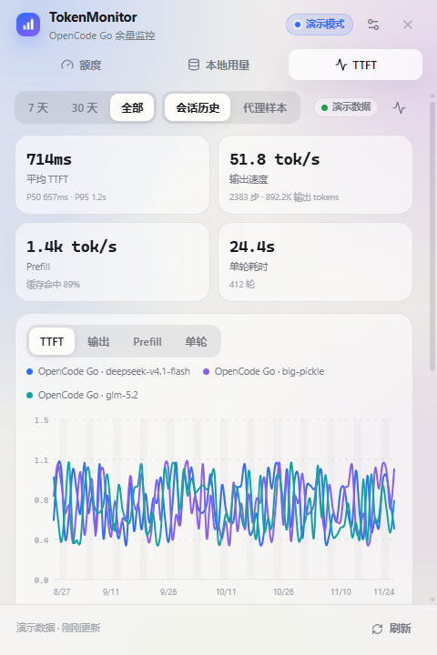
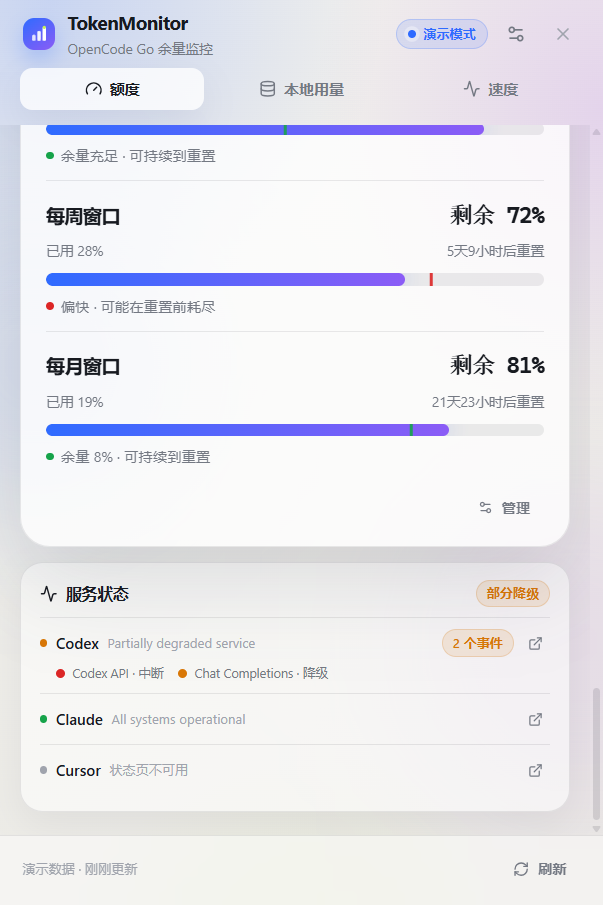

# TokenMonitor

Windows 托盘版 OpenCode Go 余量监控，参考 [CodexBar](https://github.com/steipete/CodexBar) 的产品设计，使用 Electron + React 独立实现。


## 功能

- **多 Provider 额度面板**：OpenCode Go、Codex、Claude、Cursor、Z.AI / GLM、ZCode；每个 Provider 独立显示额度窗口、重置时间和异常状态。
- **OpenCode Go 三窗口余量**：5 小时、每周、每月；显示剩余/已用百分比、重置倒计时、限流状态。
- **pace 节奏预测**：按窗口时间进度比较实际消耗，提示“余量充足 / 节奏正常 / 偏快”。
- **本地 token 统计**：只读 OpenCode SQLite，按今日 / 7 天 / 30 天 / 全部展示 token、会话、模型排行。
- **TTFT 趋势**：可选开启本地测速代理，按模型记录实时首 token 延迟；有 usage 时附带 tok/s。
- **历史性能复盘**：直接读取本机 OpenCode 会话记录，回溯 TTFT、输出 tok/s、prefill 速度与 Agent 单轮耗时；支持 7 天 / 30 天 / 全部，无需开启代理。
- **Codex 额度重置积分**：显示可用重置次数与下一次过期倒计时。
- **Provider 状态/事件**：拉取 OpenAI / Anthropic / Cursor 的公开 Statuspage，显示服务降级、事件数量和受影响组件。
- **Windows 原生体验**：系统托盘、flyout 面板、Toast 通知、开机自启、单实例、深色/浅色主题。
- **隐私优先**：凭证用 Windows DPAPI 加密；不读取 prompt、回复、工具输出或其他 Provider 的 Key；不接入遥测。



## Provider 接入

| Provider | 自动来源 | 手动凭证 |
|---|---|---|
| Codex | `~/.codex/auth.json`（OAuth） | OAuth access token |
| Claude | `~/.claude/.credentials.json`，或 `CLAUDE_OAUTH_TOKEN` | Claude Code OAuth token |
| Cursor | Cursor `state.vscdb` 中未加密的 access token | cursor.com Cookie header 或 session token |
| Z.AI / GLM | `Z_AI_API_KEY` / `BIGMODEL_API_KEY` 等环境变量；ZCode 的 Z.AI Key | API Key；团队 BigModel 可粘贴 JSON |
| ZCode | `~/.zcode/v2/config.json` 的 Coding Plan Key | API Key；团队版 JSON |

设置 → **多 Provider** 可以为每个 Provider 保存手动凭证。手动凭证使用系统加密保存，不会传给渲染进程或写入日志。

BigModel 团队版需要额外选择器，可粘贴：

```json
{
  "apiKey": "<BigModel API key>",
  "organizationId": "<Bigmodel-Organization>",
  "projectId": "<Bigmodel-Project>",
  "region": "bigmodel-cn"
}
```




## 安装 / 运行

开发：

```bash
npm install
npm run dev
```

构建 Windows 安装包：

```bash
npm run dist:win
```

产物在 `release/`。当前安装包未签名，Windows SmartScreen 可能提示；选择“更多信息 → 仍要运行”。

> macOS 代码保持跨平台，但本项目当前只产出 Windows 安装包；macOS 需要在 macOS/CI 上构建。

## 首次使用

1. 打开 [OpenCode 控制台](https://opencode.ai/auth) 创建 API Key。
2. 在引导页粘贴 Key，点击“测试并保存”；也可以尝试检测本机 `auth.json`。
3. 本地 token 统计默认开启，会自动读取：
   - Windows：`%USERPROFILE%\.local\share\opencode\opencode.db`
   - macOS：`~/.local/share/opencode/opencode.db`
4. 需要更多 Provider 时，打开“设置 → 多 Provider”，先登录对应客户端（Codex / Claude），或填 API Key / Cookie。
5. 需要按模型查看 TTFT 时，在“设置 → 精确测速”中启用测速代理。

本机如果只有其他 Provider 的凭证（例如 DeepSeek），不会被读取或展示；OpenCode 额度必须使用 OpenCode Go 的 Key。其他 Provider 的凭证只在各自设置中读取。

## 历史性能复盘

TTFT 页的“会话历史”数据源直接读取 OpenCode SQLite 的 `message` / `part` 元数据，不查询 prompt、回复正文或工具输出：

- **TTFT**：assistant 消息创建（请求发起）→ 首个 `reasoning` / `text` part，包含请求排队与网络耗时。
- **输出 tok/s**：`step-finish` 的 output + reasoning token ÷ 各 `text` / `reasoning` part 的流式时长之和；不含首 token 等待，也排除工具执行间隔。
- **Prefill**：未命中缓存的 input（含 cache write）÷ TTFT，是估算值；同时显示缓存命中率。
- **单轮耗时**：触发该轮的 user 消息 → 该轮最后一条 assistant 消息完成，包含多步推理和工具执行。
- 每步 token 优先取 `step-finish`；缺失时回退到 message token（仅单步消息）。
- 按模型和本地自然日聚合；一轮涉及多个模型时，归到步数最多的模型。
- 区间：7 天 / 30 天按本地自然日；“全部”从最早一条消息开始。

历史值是**回放**口径，不能拆分上游服务端排队、网络和 prefill；需要严格测量时仍可使用本地代理。若 OpenCode 未来改变 `part` 时序字段，相关指标会显示为空，而不是猜测。

## 精确测速（实验性）

精确测速不是 CodexBar 的原有功能，是本项目的扩展：

- 应用在 `127.0.0.1` 启动一个本地反向代理，记录请求时间、TTFT、流式输出时长和上游 usage。
- **TTFT 是主指标**：从请求开始到第一个内容 chunk；即使上游不返回 usage，TTFT 仍会记录。
- tok/s 仅在拿到上游 usage 时作为辅助指标显示；没有 usage 时为“—”。
- 需要在 OpenCode 配置里把 Go Provider 的 `baseURL` 指向本机代理，并把设置页生成的配置片段合并进去。
- **应用退出后代理会停止**；如果配置仍指向代理，OpenCode 请求会失败。退出前请恢复原配置，或先关闭测速。
- 代理只记录模型、时间、token 数；不落盘 prompt、回复、Authorization 或工具输出。
- OpenCode 不同版本可能使用 `provider` 或 `providers` 配置结构，且 Provider ID 可能是 `opencode` 或 `opencode-go`；设置页会同时给出两种片段。
- 如果上游不返回 usage，tok/s 不可用；TTFT 不受影响。

## 数据与隐私

应用数据目录：

```
%APPDATA%\TokenMonitor\
├─ settings.json
├─ secret.bin              # DPAPI 加密
├─ quota-history\          # 90 天额度快照
├─ speed-samples\          # 90 天测速样本
└─ logs\                   # 脱敏日志
```

- 额度请求：`https://opencode.ai/zen/go/v1/usage`（未公开接口，可能随上游变化）。
- 本地统计只读取 `message` / `session_message` 的元数据；历史性能复盘只查询 `part` 的类型、时间戳和 token，不读取 `part` 正文、`session_input.prompt`、工具输出或 `auth.json` 中的其他 Provider。
- 不显示金额/余额；OpenCode 的额度接口只返回百分比。CodexBar 的成本能力没有移植。
- 本项目不是 OpenCode 或 CodexBar 的官方工具。

## 开发

```bash
npm run dev          # electron-vite 开发
npm run typecheck    # 主进程 + 渲染进程类型检查
npm test             # Vitest：API、pace、SQLite 聚合、测速代理
npm run build        # 构建 out/
npm run dist:win     # Windows NSIS 安装包
```

演示模式：

```bash
# Git Bash
TOKENMONITOR_DEMO=1 npm run dev

# PowerShell
$env:TOKENMONITOR_DEMO=1; npm run dev

# 已安装/解包的应用
TokenMonitor.exe --demo
```

演示模式使用模拟额度、模拟本地用量和模拟测速数据，不访问真实 API。

目录：

```
src/main/             Electron 主进程：API、凭证、SQLite、托盘、代理
src/preload/          contextBridge 白名单
src/renderer/         React + Tailwind 界面
src/shared/           共享类型与 IPC 定义
tests/                单元与集成测试
scripts/              图标、数据库检查、UI 冒烟脚本
resources/icons/      应用与托盘图标
```

### 下载 Electron 很慢？

如果 `npm install` 卡在 Electron 二进制下载，可以使用镜像：

```bash
# Git Bash
ELECTRON_MIRROR=https://npmmirror.com/mirrors/electron/ npm install

# PowerShell
$env:ELECTRON_MIRROR="https://npmmirror.com/mirrors/electron/"; npm install
```

## 已知限制

- OpenCode Go 的 usage 接口未公开，未来可能变更。
- Codex / Claude / Cursor 在 Windows 上没有统一的安全凭证存储；本工具优先读取各自客户端的本地登录文件，或使用手动 Token/Cookie。不会刷新 OAuth Token，过期后需要重新登录客户端或更新凭证。
- Cursor 的本地 token 如果是 Chromium DPAPI 加密的 `cursor-safe-storage`，当前不会尝试解密；请粘贴 Cookie header 或 session token。
- ZCode 自动读取当前激活的 Coding Plan 凭证；BigModel 团队版需要 Organization/Project 选择器，否则额度接口会返回“无 Coding Plan”。此时请在多 Provider 设置中粘贴团队 JSON。
- 本地 token 统计、历史性能复盘和 TTFT 目前仍只针对 OpenCode；其他 Provider 只接额度。
- 历史 TTFT 为回放值，包含请求排队与网络，无法拆分上游服务端耗时；精确测量仍以本地代理为准。
- 历史性能指标依赖 OpenCode `part` 的 `time.start` / `time.end` 和 `step-finish` token；字段缺失时该步会跳过对应指标。
- 不显示金额、余额或 credits。Codex 只显示“重置积分次数”，不显示美元成本；本地成本扫描和美元支出未启用（此前选择“不显示金额”，若要恢复可以再开）。
- 服务状态来自公开 Statuspage：OpenAI、Anthropic、Cursor；Z.AI/ZCode 暂未发现稳定状态页。
- 状态页请求失败时显示“状态页不可用”，不影响额度卡片。
- 精确测速需要手动修改 OpenCode 配置，属于实验性功能；目前支持 HTTP/SSE，不支持 WebSocket 传输的测速。
- 测速的“精确”指本机请求计时；TTFT 为主指标，tok/s 依赖上游 usage，缺失时不会伪造。
- Windows 安装包未签名；macOS 未提供首版构建。
- 本地数据库可能是 v1（`message`）或 v2（`session_message`）；混合迁移库按 message id 去重，但仍建议保留 OpenCode 原库，不要用本工具修改它。
- 历史性能复盘依赖 `message` / `part` 表；如果 OpenCode 以后只在 `session_message` 中保存步骤与时间，历史页会显示无数据。
- 同一会话的 fork / 复制消息目前未单独去重，历史指标可能重复计入；子会话（subagent）会作为真实步骤计入。
- Codex / Claude / Cursor / Z.AI / ZCode 的额度解析用 mock fixture 测试；没有用这些账号做真实端到端验证（本机只有 OpenCode 和 ZCode 本机凭证）。

## 归属

设计灵感与数据源行为参考 [CodexBar](https://github.com/steipete/CodexBar)（MIT）。本项目与 OpenCode、CodexBar 无隶属关系。

License: MIT，见 [LICENSE](LICENSE) 与 [NOTICE](NOTICE)。
